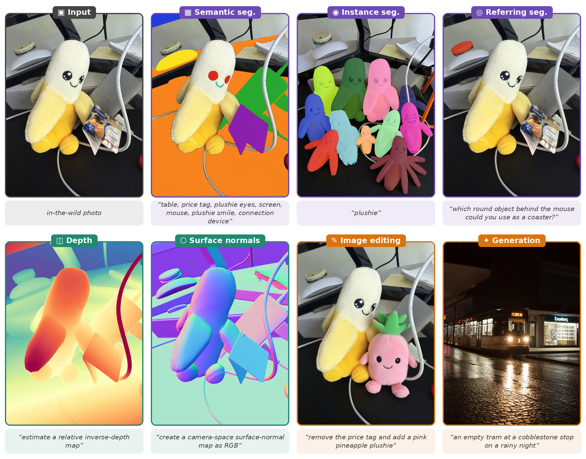
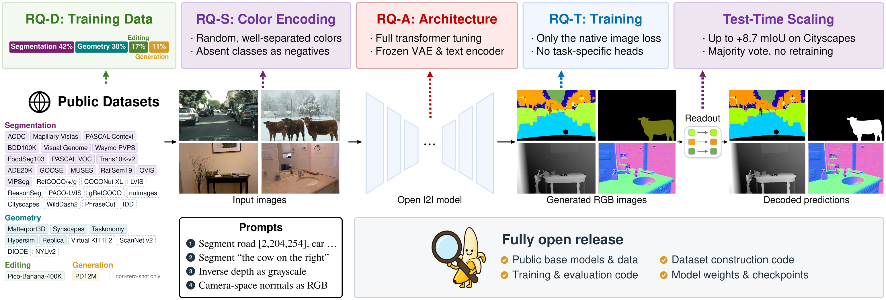
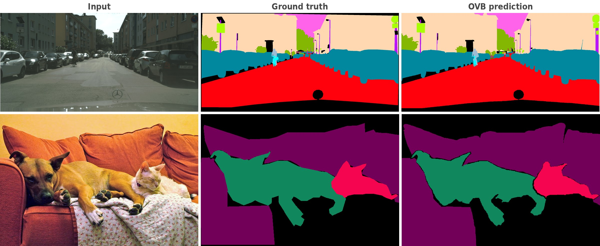
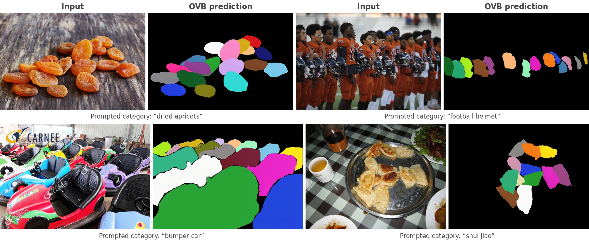
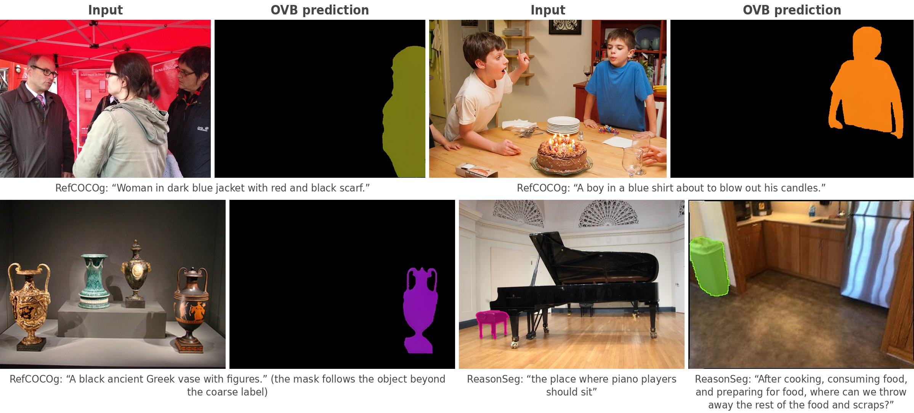
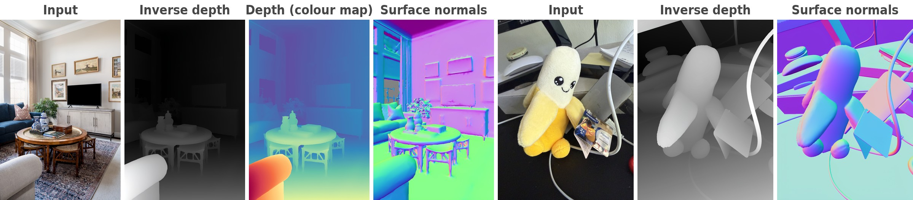
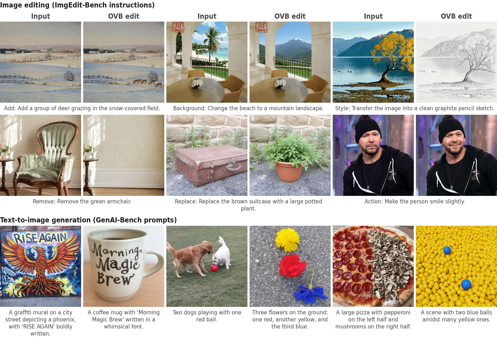

<p align="center"></p>
<h1 align="center">Open Vision Banana</h1>
<h3 align="center">A Fully Open Recipe for Generative Visual Perception</h3>

<p align="center">
<a href="https://arxiv.org/abs/2611.15844"></a>
<a href="https://openvisionbanana.github.io/"></a>
<a href="https://huggingface.co/FunAILab/Open-Vision-Banana"></a>
<a href="https://huggingface.co/spaces/arpitjadon/Open-Vision-Banana"></a>
</p>

<p align="center">
<a href="#-quick-start">Quick start</a> &nbsp;·&nbsp;
<a href="PROMPTS.md">Prompts</a> &nbsp;·&nbsp;
<a href="#-model-zoo">Model zoo</a> &nbsp;·&nbsp;
<a href="#-results">Results</a> &nbsp;·&nbsp;
<a href="#qualitative-results">Qualitative results</a> &nbsp;·&nbsp;
<a href="DATASET.md">Datasets</a> &nbsp;·&nbsp;
<a href="TRAIN.md">Training</a> &nbsp;·&nbsp;
<a href="EVALUATION.md">Evaluation</a>
</p>
 
<p align="center">
Arpit Jadon<sup>1,2*</sup> &emsp;
Valentinos Pariza<sup>1*</sup> &emsp;
Jona Ruthardt<sup>1</sup> &emsp;
Ryousuke Yamada<sup>1,3</sup> &emsp;
A. Sophia Koepke<sup>4,5</sup> &emsp;
Andrei Bursuc<sup>6</sup> &emsp;
Yuki M. Asano<sup>1</sup>
<br>
<sup>1</sup>UTN &emsp;&emsp; <sup>2</sup>DLR &emsp;&emsp; <sup>3</sup>AIST &emsp;&emsp;
<sup>4</sup>University of Tübingen, Tübingen AI Center &emsp;&emsp; <sup>5</sup>TUM, MCML &emsp;&emsp; <sup>6</sup>valeo.ai
&emsp;&emsp; <sup>*</sup>Equal contribution
</p>

<p align="center">

</p>
<p align="center"><i>Outputs of the zero-shot 9B model on an in-the-wild photo, with the summarised prompt below each output.</i></p>

<p align="center">

</p>
<p align="center"><i>Overview of the recipe. Open image generators are adapted on public datasets so that they express perception outputs as RGB images.</i></p>

## ✨ Highlights

- 🍌 **One model for every task.** A single fine-tuned FLUX.2 [klein] base transformer performs semantic, instance and referring segmentation, depth and surface normal estimation, image editing and text-to-image generation. The prompt selects the task.
- 🔓 **Fully open.** The models are trained from public base models on public datasets, and the repository contains every script from data download to scoring.
- 🎯 **Strong zero-shot perception.** OVB exceeds the zero-shot Cityscapes score reported for Vision Banana (73.9 vs. 69.9 mIoU) and is competitive with state-of-the-art affine-invariant depth estimators, while it largely retains the editing ability of the base model.
- 🗳️ **Legend ensembling.** Re-sampling the colour legend of a segmentation prompt and voting over the outputs is a new test-time scaling axis for generative segmentation. It raises the zero-shot 9B model by up to 8.7 mIoU on Cityscapes and 15.0 mIoU on COCO-Object without retraining.
- ⚖️ **4B and 9B checkpoints** are released for the zero-shot and non-zero-shot training mixes, together with the ablation models and LoRA adapters from the paper.

## 📰 Updates

- We have added a [Hugging Face demo](https://huggingface.co/spaces/arpitjadon/Open-Vision-Banana) that runs the 9B non-zero-shot checkpoint on ZeroGPU.
- Data pipelines, training and evaluation code, and model weights are all released.

## 🚀 Quick start

To try the model without installing anything, open the
[online demo](https://huggingface.co/spaces/arpitjadon/Open-Vision-Banana), which runs the 9B non-zero-shot checkpoint on ZeroGPU.

Install the pinned requirements, which include the CUDA 12.8 builds of PyTorch 2.11
(see [Installation](MAIN.md#installation) for the full environment):

```bash
python -m pip install -r requirements.txt
```

The fine-tuned transformer replaces the transformer of the FLUX.2 [klein] base
pipeline. One model handles every task and the prompt selects it. The example
below runs the pipeline with a semantic segmentation prompt:

```python
import torch
from diffusers import Flux2KleinPipeline, Flux2Transformer2DModel
from diffusers.utils import load_image
from PIL import Image

device = "cuda"
dtype = torch.bfloat16

transformer = Flux2Transformer2DModel.from_pretrained(
    "FunAILab/Open-Vision-Banana",
    subfolder="final_models/9B/nonzeroshot/checkpoint-avg82500-85000-87500-92500-97500_uniform/transformer",
    torch_dtype=dtype,
)
pipe = Flux2KleinPipeline.from_pretrained(
    "black-forest-labs/FLUX.2-klein-base-9B", transformer=transformer, torch_dtype=dtype
)
pipe.enable_model_cpu_offload()  # save some VRAM by offloading the model to CPU

image = load_image("street.jpg")
prompt = (
    "[TASK: SEMANTIC_SEGMENTATION] Generate a semantic segmentation visualization of "
    'the input image, using this color mapping: {"road": [8,4,249], "sidewalk": [255,8,232], '
    '"vegetation": [10,255,2], "sky": [2,204,254], "person": [255,0,13], "car": [255,249,23]} '
    "Color each pixel of a listed class with its color and leave everything else black. "
    "Output only the segmentation visualization image."
)

# The pipeline runs at the input's aspect ratio, capped at 1 megapixel.
output = pipe(
    prompt=prompt,
    image=image,
    guidance_scale=3.5,
    num_inference_steps=28,
    generator=torch.Generator(device=device).manual_seed(0),
).images[0]
# Back to the input size: NEAREST keeps mask colours exact; use Image.BILINEAR for depth and normals.
output.resize(image.size, Image.NEAREST).save("output.png")
```

[`scripts/infer.py`](scripts/infer.py) wraps the same call. It also accepts local
snapshots and selects the fine-tuned transformer by hub subfolder:

```bash
python scripts/infer.py --image street.jpg --out seg.png --prompt-file prompt.txt \
  --model black-forest-labs/FLUX.2-klein-base-9B \
  --transformer-path FunAILab/Open-Vision-Banana \
  --subfolder final_models/9B/nonzeroshot/checkpoint-avg82500-85000-87500-92500-97500_uniform/transformer
```

<p>👉 <a href="PROMPTS.md"></a></p>

For benchmark evaluation, dataset preparation and training, use the repository
scripts described in [EVALUATION.md](EVALUATION.md), [DATASET.md](DATASET.md)
and [TRAIN.md](TRAIN.md).

## 📦 Model zoo

All weights are fine-tuned FLUX.2 [klein] transformers hosted at
[FunAILab/Open-Vision-Banana](https://huggingface.co/FunAILab/Open-Vision-Banana).
Load them with `subfolder=<path>/transformer` as in the quick start, and pair
them with the matching base model. The training mixes carry the paper's colours.
The  *zero-shot* models are
trained without the training splits of the evaluation benchmarks, and the
 *non-zero-shot* models
include those splits in the training mix.

| Model | Base | Training mix | Hugging Face folder | Paper checkpoint |
|---|---|:---:|---|---|
| OVB 9B zero-shot | [FLUX.2-klein-base-9B](https://huggingface.co/black-forest-labs/FLUX.2-klein-base-9B) |  ZS | [`final_models/9B/zeroshot/`](https://huggingface.co/FunAILab/Open-Vision-Banana/tree/main/final_models/9B/zeroshot) | `checkpoint-coco86750-w25` |
| OVB 9B non-zero-shot | FLUX.2-klein-base-9B |  NZS | [`final_models/9B/nonzeroshot/`](https://huggingface.co/FunAILab/Open-Vision-Banana/tree/main/final_models/9B/nonzeroshot) | `checkpoint-avg82500-85000-87500-92500-97500_uniform` |
| OVB 4B zero-shot | [FLUX.2-klein-base-4B](https://huggingface.co/black-forest-labs/FLUX.2-klein-base-4B) |  ZS | [`final_models/4B/zeroshot/`](https://huggingface.co/FunAILab/Open-Vision-Banana/tree/main/final_models/4B/zeroshot) | `checkpoint-87500-95000-w25` |
| OVB 4B non-zero-shot | FLUX.2-klein-base-4B |  NZS | [`final_models/4B/nonzeroshot/`](https://huggingface.co/FunAILab/Open-Vision-Banana/tree/main/final_models/4B/nonzeroshot) | `checkpoint-avg90000-92500-97500-100000_uniform` |

Each folder holds the intermediate `checkpoint-<step>` exports and the
weight-averaged or merged checkpoint used in the paper (last column), each with
a `transformer/` subfolder, its training arguments, dataset specification and
checksums. The ablation models and the LoRA adapters of the paper are under
[`ablation_models/`](https://huggingface.co/FunAILab/Open-Vision-Banana/tree/main/ablation_models).

## 📊 Results

| Model | 🏙️ Sem. seg.<br>Cityscapes val<br>mIoU ↑ | 🗣️ Ref. seg.<br>RefCOCOg val (UMD)<br>cIoU ↑ | 🧠 Reasoning seg.<br>ReasonSeg val<br>gIoU ↑ | 🧩 Inst. seg.<br>SA-Co/Gold<br>cgF1 ↑ | 📏 Depth<br>NYUv2<br>δ<sub>1</sub> (%) ↑ | 🧭 Surf. normal<br>NYUv2<br>mean err. (°) ↓ |
|---|:---:|:---:|:---:|:---:|:---:|:---:|
|  OVB (F2K9B Base, zero-shot) | 73.9 | 57.4 | 67.1 | 37.9<sup>★</sup> | 97.4 | 19.85 |
|  OVB (F2K9B Base, non-zero-shot) | 75.7 | **69.2** | 68.6 | **40.1**<sup>★</sup> | **99.0** | 13.51 |
|  OVB (F2K4B Base, zero-shot) | 71.3 | 57.0 | 67.9 | 34.0 | 97.5 | 19.87 |
|  OVB (F2K4B Base, non-zero-shot) | **76.4** | 65.6 | **74.6** | 35.9 | 98.7 | **13.21** |

<sub>★ With the Qwen3-VL-30B-A3B presence gate. With the Qwen3-VL-8B-Instruct gate used for the 4B rows, the 9B models score 37.4 (zero-shot) and 39.6 (non-zero-shot).</sub>

Cityscapes and SA-Co/Gold scores use legend ensembling with 20 and 11 passes,
SA-Co/Gold scores use an MLLM presence gate, and ReasonSeg scores use Gemma 4 31B
query rewrites. Depth uses per-image disparity-affine alignment. The protocols,
the optional test-time scaling settings and the per-benchmark commands are
described in [EVALUATION.md](EVALUATION.md#reproducing-the-paper). The SA-Co/Gold
image subset and presence gates used for instance segmentation, and the ReasonSeg
query rewrites, are bundled under [`evaluation/assets/`](evaluation/assets/).

## 🗺️ Repository guide

Evaluating a released model does not require the training datasets.

| I want to… | Start here |
|---|---|
| 🔧 Install the project | [Installation](MAIN.md#installation) |
| 🖼️ Run a model on my own image | [Online demo](https://huggingface.co/spaces/arpitjadon/Open-Vision-Banana), [quick start](#-quick-start), [prompts for every task](PROMPTS.md) |
| 📏 Evaluate a pretrained or OVB model | [Evaluation commands](EVALUATION.md#task-commands) |
| 📄 Reproduce the paper tables | [Paper reproduction](EVALUATION.md#reproducing-the-paper) |
| 📥 Download and prepare training data | [ZS/NZS data setup](DATASET.md#complete-zs-and-nzs-recipes) |
| 🔐 Obtain datasets that require registration | [Download and manual inputs](DATASET.md#how-to-download-the-data) |
| 🏋️ Fine-tune a model | [Training](TRAIN.md#run) |
| 🖥️ Submit on a Slurm cluster | [`examples/jobs/train_flux2_klein_9b.job`](examples/jobs/train_flux2_klein_9b.job), [`examples/jobs/evaluate_release.job`](examples/jobs/evaluate_release.job) |
| 🧪 Try a small data-setup check | [Smoke tests](DATASET.md#small-smoke-tests) |

<a id="qualitative-results"></a>

## 🖼️ Qualitative results

All examples below are predictions of the zero-shot 9B model. Segmentation
outputs are shown after the colour readout described in the paper.

 &nbsp; Cityscapes (top) and COCO-Object-80 (bottom), with the ground truth in the middle column.

<p align="center"></p>

 &nbsp; SA-Co/Gold. Each prompt names one category, and the model paints every instance of it in a different colour.

<p align="center"></p>

 &nbsp; RefCOCOg and ReasonSeg. The referring expression is written under each example, and the ReasonSeg masks are overlaid on the input image.

<p align="center"></p>

 &nbsp;  &nbsp; Two in-the-wild photos. The inverse depth map is shown as predicted and with a colour map.

<p align="center"></p>

 &nbsp;  &nbsp; Image editing on ImgEdit-Bench instructions and text-to-image generation on GenAI-Bench prompts, both after perception tuning.

<p align="center"></p>

## 📄 License

The released weights are derived from FLUX.2 [klein] Base and are distributed
under the [FLUX Non-Commercial License](https://huggingface.co/black-forest-labs/FLUX.2-klein-base-9B/blob/main/LICENSE.md).
The code is released under the [Apache License 2.0](https://www.apache.org/licenses/LICENSE-2.0).
See [LICENSE](LICENSE). Datasets keep the licenses of their original
distributions, which are listed in [DATASET.md](DATASET.md).

## 📚 Citation

If you use Open Vision Banana in your research, please cite:

```bibtex
@misc{jadon2026openvisionbananafully,
      title={Open Vision Banana: A Fully Open Recipe for Generative Visual Perception},
      author={Arpit Jadon and Valentinos Pariza and Jona Ruthardt and Ryousuke Yamada and A. Sophia Koepke and Andrei Bursuc and Yuki M. Asano},
      year={2026},
      eprint={2611.15844},
      archivePrefix={arXiv},
      primaryClass={cs.CV},
      url={https://arxiv.org/abs/2611.15844},
}
```
